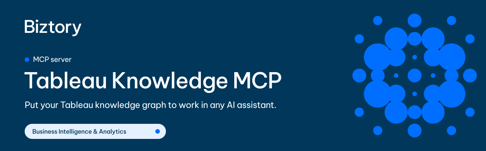
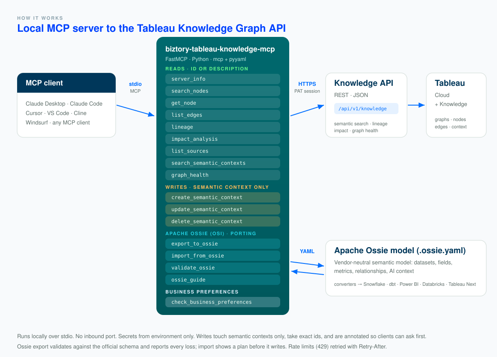

<!-- mcp-name: io.github.biztory/biztory-tableau-knowledge-mcp -->

<p align="center">
  
</p>

<h1 align="center">biztory-tableau-knowledge-mcp</h1>

<p align="center"><b>Put your Tableau knowledge graph to work in any AI assistant.</b><br>Search it by meaning, trace lineage and impact, and enrich it with business context.</p>

<p align="center">
  <a href="https://github.com/biztory/biztory-tableau-knowledge-mcp/actions/workflows/ci.yml"></a>
  <a href="https://github.com/biztory/biztory-tableau-knowledge-mcp/actions/workflows/codeql.yml"></a>
  <a href="https://github.com/biztory/biztory-tableau-knowledge-mcp/actions/workflows/fuzz.yml"></a>
  <a href="https://securityscorecards.dev/viewer/?uri=github.com/biztory/biztory-tableau-knowledge-mcp"></a>
  <a href="https://github.com/astral-sh/ruff"></a>
  <a href="https://pypi.org/project/biztory-tableau-knowledge-mcp/"></a>
  
  
  <a href="LICENSE"></a>
  
  
</p>

<p align="center">
  <a href="cursor://anysphere.cursor-deeplink/mcp/install?name=tableau-knowledge&config=eyJjb21tYW5kIjogInV2eCIsICJhcmdzIjogWyJiaXp0b3J5LXRhYmxlYXUta25vd2xlZGdlLW1jcCJdfQ=="></a>
  <a href="https://vscode.dev/redirect/mcp/install?name=tableau-knowledge&config=%7B%22command%22%3A%22uvx%22%2C%22args%22%3A%5B%22biztory-tableau-knowledge-mcp%22%5D%7D"></a>
</p>

---

**biztory-tableau-knowledge-mcp** turns your site's [Tableau Knowledge Graph API](https://help.tableau.com/current/api/rest_api/en-us/REST/rest_api_ref_tableau_knowledge_graph.htm) into twelve MCP tools, so an AI assistant (Claude, Cursor, VS Code, Cline, and others) can work with the graph in plain language:

- _"Which fields mean **revenue**, and where do they come from?"_
- _"If the **Superstore** data source changes, which workbooks and dashboards are affected?"_
- _"What business context is attached to **Profit**? Add: 'Profit is after returns, in EUR.'"_
- _"How healthy is our graph, and what are the five highest-impact fixes?"_

It ships **nine read tools** (semantic search, node lookup, edges, lineage, impact, sources, semantic contexts, graph health, and a connection probe) and **three write tools** that only touch semantic contexts, the business statements that make the graph useful to people and to AI.

### Why it's different

- **Ask by meaning, not by id.** Every read tool takes a node id *or* a description ("the net sales field"). Descriptions resolve through the graph's own semantic search, and the answer says which node it picked, with the match score and runners-up, so a wrong guess is visible instead of silent.
- **Answers, not payloads.** `impact_analysis` groups and counts everything downstream by type; `lineage` adds node and edge counts; `graph_health` caps hundreds of suggestions to the top ones while keeping every total.
- **Errors tell the model what to do next.** Tableau's error codes become concrete steps (`site_not_entitled` → an admin must enable Knowledge; `no_active_graph` → pass a `graph_id`; no embedder → use exact ids), with the `trace_id` kept for support. Rate limits are retried with `Retry-After`.
- **Writes you can trust.** Only semantic contexts can be written. Write tools take exact ids (a fuzzy match never decides where a write lands), validate before sending, carry honest MCP annotations so clients ask first, and `delete_semantic_context` returns what it deleted.
- **Tiny and hardened.** Stdio only (no inbound port), secrets from env only, HTTPS enforced, redirects refused, ids encoded so they can never reach another endpoint, fuzzed parsers, and **no dependencies beyond the MCP SDK** (stdlib `urllib` for HTTP).

## Requirements

Tableau Knowledge is a **Tableau Cloud** feature (September 2026 and later, Tableau+ license); it is not available on Tableau Server. Any user can read the graph, filtered by their content permissions. Writing semantic contexts needs the **Creator** role.

## Quickstart

You need [`uv`](https://docs.astral.sh/uv/) (`curl -LsSf https://astral.sh/uv/install.sh | sh`) and a Tableau [Personal Access Token](https://help.tableau.com/current/online/en-us/security_personal_access_tokens.htm).

**Claude Code, one line:**

```bash
claude mcp add tableau-knowledge \
  -e TABLEAU_SERVER=https://10ax.online.tableau.com \
  -e TABLEAU_SITE_CONTENT_URL=YourSite \
  -e TABLEAU_PAT_NAME=my-token \
  -e TABLEAU_PAT_SECRET=the-full-secret \
  -- uvx biztory-tableau-knowledge-mcp
```

That's all. `uvx` fetches the package from PyPI and runs it in an isolated environment; nothing to clone or install. Then ask: _"Use server_info: what graphs does my site have?"_

## Configuration

All configuration is via environment variables (set them in your client's `env` block, never on the command line).

| Env var | Required | Default | Description |
|---|:---:|---|---|
| `TABLEAU_SERVER` | yes | n/a | `https://<pod>.online.tableau.com`. Any URL from your browser works; the path is stripped. |
| `TABLEAU_SITE_CONTENT_URL` | yes | `""` | Site slug (the part after `/#/site/`). |
| `TABLEAU_PAT_NAME` | yes¹ | n/a | Personal Access Token **name**. |
| `TABLEAU_PAT_SECRET` | yes¹ | n/a | PAT **secret**: the whole string, do **not** split on `:`. |
| `TABLEAU_KNOWLEDGE_GRAPH_ID` | no | primary graph | Default graph for every tool. `server_info` lists the site's graphs; each tool also takes a `graph_id`. |
| `TABLEAU_TIMEOUT` | no | `60` | Per-request timeout (seconds). |
| `TABLEAU_API_VERSION` | no | auto | REST version used for sign-in; else read from serverinfo. (The Knowledge API itself is always `v1`.) |
| `TABLEAU_ALLOW_HTTP` | no | off | Set to `1` to allow a plain `http://` server on a trusted network. Otherwise only HTTPS (or loopback). |
| `TABLEAU_LOG_LEVEL` | no | `INFO` | `DEBUG` logs each HTTP call (method + URL; never headers, bodies or secrets) to stderr. |
| `TABLEAU_AUTH_TOKEN` | no | n/a | Advanced: a pre-obtained `X-Tableau-Auth` session token instead of a PAT. |

¹ Provide a PAT (`TABLEAU_PAT_NAME` + `TABLEAU_PAT_SECRET`) **or** `TABLEAU_AUTH_TOKEN`.

<details>
<summary><b>Claude Desktop</b></summary>

Edit `claude_desktop_config.json` (macOS: `~/Library/Application Support/Claude/`, Windows: `%APPDATA%\Claude\`):

```json
{
  "mcpServers": {
    "tableau-knowledge": {
      "command": "uvx",
      "args": ["biztory-tableau-knowledge-mcp"],
      "env": {
        "TABLEAU_SERVER": "https://10ax.online.tableau.com",
        "TABLEAU_SITE_CONTENT_URL": "YourSite",
        "TABLEAU_PAT_NAME": "my-token",
        "TABLEAU_PAT_SECRET": "the-full-secret"
      }
    }
  }
}
```

Fully **quit and reopen** Claude Desktop, then check the tools menu.
</details>

<details>
<summary><b>Cursor</b> · <b>VS Code</b> · <b>Cline</b> · <b>Windsurf</b></summary>

Use the **Add to Cursor** / **Add to VS Code** buttons above and fill in the `env` values, or add the same block as for Claude Desktop to:
- **Cursor**: `~/.cursor/mcp.json` (global) or `.cursor/mcp.json` (project).
- **VS Code**: `.vscode/mcp.json` (the top-level key there is `servers` instead of `mcpServers`).
- **Cline**: the MCP Servers panel, then *Configure*, into `cline_mcp_settings.json`.
- **Windsurf**: `~/.codeium/windsurf/mcp_config.json`.

On Windows, if `uvx` isn't found by the GUI app, use its absolute path (e.g. `%USERPROFILE%\.local\bin\uvx.exe`).
</details>

## Tools

`node` arguments accept a node id **or** a plain-language description. Every graph-scoped tool also takes an optional `graph_id`.

| Tool | What it does | Key args |
|---|---|---|
| `server_info` | Site, versions, auth, whether Knowledge is enabled, and every graph (id, name, status, primary). Good first call. | none |
| `search_nodes` | Semantic search over the graph ("revenue" finds "Net Sales"), ranked with scores. | `query`, `node_type`, `scope_id`, `limit`, `threshold` |
| `get_node` | One node: properties, attached semantic statements, child nodes. | `node`, `include_children` |
| `list_edges` | The edges around one node, with direction and the node on the other end. | `node`, `edge_type`, `direction` |
| `lineage` | Upstream and downstream neighborhood (10 steps) along lineage/dependency edges, with counts. | `node` |
| `impact_analysis` | Everything that depends on a node, transitively, grouped and counted by type. | `node` |
| `list_sources` | The published data sources and workbooks the graph is built from. | `node_type` |
| `search_semantic_contexts` | Business statements on the graph: all, graph-wide only, or attached to one node. | `node`, `is_global` |
| `graph_health` | Health score, coverage metrics, and prioritized improvement suggestions. | `pds_id`, `severity`, `suggestion_type`, `limit` |
| `create_semantic_context` | (write) Attach statements to one node (exact id) or to the whole graph. | `statements`, `target_node_id` / `is_global`, `name` |
| `update_semantic_context` | (write) Replace statements, rename, re-attach, or make graph-wide. | `ctx_id`, `statements`, `name`, `attach_to` / `make_global` |
| `delete_semantic_context` | (write) Delete a user-managed context; returns what was deleted. | `ctx_id` |

Write tools are annotated `readOnlyHint: false` (update and delete also `destructiveHint: true`) so your client can ask before each one. Tableau-managed (`SEMANTIC_CONTEXT_EXTERNAL`) contexts are read-only.

## How a description becomes a node

```text
# illustrative
"the net sales field"
   │  1. exact lookup: GET /nodes/{id}           → found? use it, no guessing
   │  2. not an id: semantic search (top 4)      → best match + runners-up
   ▼
{ "id": "field:…:Net Sales", …,
  "resolution": { "match": {"name": "Net Sales", "type": "FIELD", "score": 0.82},
                  "alternatives": [ … ],
                  "note": "Not an exact id: resolved by semantic search …" } }
```

The model sees the score and the alternatives, so it can confirm with you or retry with an alternative's id. Write tools skip this step entirely and require exact ids.

## Example prompts

- _"Use server_info: which graphs does this site have, and which is primary?"_
- _"Find the fields that mean revenue, then show the lineage of the best match."_
- _"Run impact_analysis on the Superstore data source: which workbooks and dashboards depend on it?"_
- _"What semantic context is attached to the Profit field?"_
- _"Show the graph's health score and the five high-severity suggestions, with the nodes they target."_
- _"Add a statement to the Profit field: 'Profit is calculated after returns and reported in EUR.'"_

## Architecture

<p align="center"></p>

The server speaks MCP over **stdio** to the client and HTTPS to Tableau: it signs in with your PAT to get an `X-Tableau-Auth` session (refreshed on expiry), then calls `/api/v1/knowledge`. Nothing is stored; every answer is live.

## Things the API does that you should know

- **Search is by meaning.** Scores are relative; a top score around 0.4-0.5 can still be the right node, so check the alternatives.
- **Lineage follows dependencies, not containment.** A single field's lineage is often just itself; `list_edges` shows which table HAS it.
- **Context search doesn't filter by text yet.** `search_semantic_contexts` filters by node or `is_global`; find statements by meaning with `search_nodes`.
- **Unknown ids behave differently per endpoint.** The API's lineage returns an empty graph for an unknown id; this server resolves the node first, so you always get a clear error instead.
- **Deletes are idempotent.** Deleting an unknown id succeeds without effect.
- **The API is rate-limited.** Crawling a large graph node by node hits HTTP 429; the server retries with back-off, but prefer `lineage` and `impact_analysis` over many `get_node` calls.

## Security

- **Writes are limited to semantic contexts**, take exact ids, are validated before sending, and are annotated so your client can ask first. A Viewer or Explorer PAT makes the server read-only in practice.
- **Local and stdio-only.** No inbound network port is opened.
- **Secrets from env only.** Never tool arguments, never logged, never returned.
- **Credentials go only to your Tableau host.** HTTPS required, certificates verified, redirects refused.
- **No injection through ids.** Node and context ids are encoded as one path segment; `graph_id` is checked against Tableau's pattern before it is sent. Both parsers of untrusted input are fuzzed in CI.
- **Verifiable releases.** Every GitHub release carries Sigstore signatures and a CycloneDX SBOM, and PyPI uploads use Trusted Publishing.
- Pin a version in production: `uvx biztory-tableau-knowledge-mcp==0.1.0`.

See [SECURITY.md](SECURITY.md) for the threat model, data handling, disclosure policy and how to verify a release.

## Troubleshooting

| Symptom | Fix |
|---|---|
| Server doesn't appear | Fully quit and relaunch the client; check the config path and JSON validity. |
| `spawn uvx ENOENT` | Install `uv`, or use the absolute path to `uvx`. |
| Sign-in fails (401, `401001`) | The PAT is invalid or expired (15 days unused). Create a new one and check `TABLEAU_SITE_CONTENT_URL`. |
| `site_not_entitled` | The site doesn't have Tableau Knowledge; a Tableau Cloud Manager admin must enable it. |
| `no_active_graph` | The site has no primary graph: pass a `graph_id` from `server_info`. |
| "Semantic search is unavailable" | The graph has no embedder. Use exact ids (`list_sources` → `get_node`). |
| `tableau_forbidden` on a write | Writing semantic contexts needs the Creator role. |
| HTTP 429 after retries | You hit Tableau's rate limit; wait a minute and use fewer, broader calls. |

Inspect the server directly with the MCP Inspector:

```bash
npx @modelcontextprotocol/inspector uvx biztory-tableau-knowledge-mcp
```

## Development

```bash
git clone https://github.com/biztory/biztory-tableau-knowledge-mcp && cd biztory-tableau-knowledge-mcp
uv sync --all-extras
uv run biztory-tableau-knowledge-mcp                   # run from source (needs the env vars above)
uv run pytest --cov=biztory_tableau_knowledge_mcp      # tests + coverage (offline; no Tableau needed)
uv run ruff check . && uv run ruff format --check . && uv run mypy
```

Tool tests run through the real client against an in-process fake of the Knowledge API (`tests/conftest.py`), so URL building, id encoding and error mapping are all exercised. Live tests are opt-in: `TABLEAU_LIVE=1` runs the read-only ones; `TABLEAU_LIVE_WRITE=1` adds a round trip that creates, updates and deletes one temporary context it made itself.

The same gates run in CI (Linux/macOS/Windows, Python 3.10 to 3.13): `ruff check`, `ruff format --check`, `mypy --strict`, and `pytest` with a coverage floor. CodeQL scans every push, the OpenSSF Scorecard runs weekly, and a fuzzing job (`fuzz/`) attacks the untrusted-input parsers. The package ships a PEP 561 `py.typed` marker.

Contributions welcome: see [CONTRIBUTING.md](CONTRIBUTING.md) and the [Code of Conduct](CODE_OF_CONDUCT.md).

## Roadmap

- [ ] Import an OSI (Open Semantic Interchange) model as semantic contexts
- [ ] A demo recording in this README
- [ ] Optional per-session caching of `server_info` and resolved nodes

Ideas and votes welcome in [Discussions](https://github.com/biztory/biztory-tableau-knowledge-mcp/discussions).

## License

[MIT](LICENSE) © [Biztory](https://www.biztory.com). Sister project: [tableau-graphql-mcp](https://github.com/tdries/tableau-graphQL-mcp) for lineage over the Tableau Metadata API.
